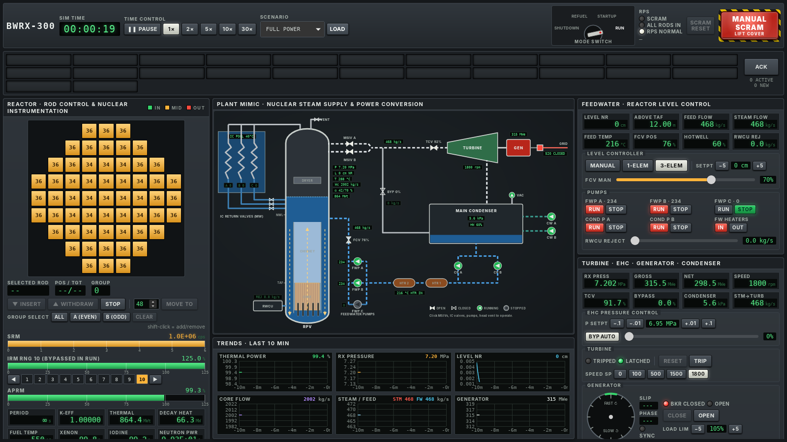

# BWRX-300 Control Room Simulator

A desktop game in the spirit of [Nucleares](https://store.steampowered.com/app/1428420/Nucleares/), but the plant is a
**GE Hitachi BWRX-300**: a 300 MWe boiling water reactor with **no recirculation pumps**. Water moves through the core by
natural circulation alone, so you control the plant with the 57 control rods, the feedwater system, the turbine and
pressure control. Pressure, water level, feedwater temperature and steam voids in the core all push reactor power around.
Learning how they interact is the game.



## Status

This is the first milestone. It covers the reactor, feedwater and turbine-generator systems (Jim's chosen scope):

| Area | What is simulated |
|---|---|
| Neutronics | Point kinetics with 6 delayed neutron groups, neutron source, period meter, SRM / IRM (10 ranges) / APRM |
| Reactivity | 57 bottom-entry rods with radial and axial worth, Doppler, void, moderator temperature, xenon-135 / iodine-135 |
| Decay heat | 9-group fit to the standard decay heat curve (7.7 % at shutdown, 1.3 % after 1 h) |
| Fuel | Lumped fuel temperature, degraded cooling when the core uncovers, core damage above 1200 °C |
| Vessel | Mass and energy balance with real IAPWS-IF97 steam tables, so pressure, flashing, swell and shrink are physical |
| Natural circulation | Core flow from the density difference between downcomer and core + chimney, drift-flux voids, flow stops if level falls below the chimney top |
| Steam | 2 main steam lines with MSIVs, turbine control valves, 100 % turbine bypass to the condenser, head vent |
| Turbine-generator | EHC pressure regulator ("reactor leads"), speed governor, shaft dynamics, synchroscope, generator breaker, overspeed |
| Condenser | Circulating water pumps, vacuum pump, air in-leakage, hotwell inventory |
| Feedwater | 2 condensate + 3 feed pumps with pump curves, equal-percentage control valve, manual / 1-element / 3-element level control, feedwater heating from turbine extraction, RWCU reject |
| Isolation condensers | 3 passive trains with pools that heat up and boil off |
| Protection | Mode switch, scram (APRM, IRM, pressure, level, MSIV closure), rod blocks, MSIV isolation, IC auto-start, Select Rod Insert on turbine trip, L8 turbine trip |

Scenarios: **cold shutdown** (30 days after shutdown, vessel vented), **hot standby** (pressurised, condenser on line) and
**full power**.

## Playing

1. Start from **hot standby**. Put the mode switch in **STARTUP**.
2. Pull rods a notch at a time. Watch the SRM count rate climb and keep the **period** longer than about 60 s.
   Range the **IRMs** up as power rises, or they will scram you.
3. As the core heats and voids form, water **swells** into the steam dome. Lower the level setpoint and use **RWCU reject**
   to keep level below L8, or the turbine and feed pumps trip.
4. When pressure reaches the setpoint the **bypass valves** open. **Reset** the turbine and set speed to **1800 rpm**.
5. When the synchroscope turns slowly and points near 12 o'clock, **close the breaker**. Switch the mode switch to **RUN**
   before APRM passes 15 %.
6. Start the second condensate and feed pumps, switch level control to **3-element**, and keep pulling rods.
   Xenon will fight you for the next day of game time.

Things that will bite you: cold feedwater adds reactivity, raising pressure collapses voids and raises power, losing
feedwater heating raises power, and placing the mode switch in RUN arms the low steam pressure MSIV isolation.

## Building

You need [Rust](https://rustup.rs), Node.js 22, and on Linux the WebKitGTK libraries
(`libwebkit2gtk-4.1-dev librsvg2-dev`).

```sh
npm install
npm install --prefix ui
npm run dev      # run the desktop app with hot reload
npm run build    # build an installer in target/release/bundle
npm test         # physics tests
```

`npm run ui:dev` runs just the panels in a browser against a rough mock of the plant, which is handy for UI work.

## Project layout

- `crates/bwr-core` is the physics engine in Rust, with no UI code. `params.rs` holds every plant parameter. Each one is
  marked **CONFIRMED** (from public GE Hitachi / NRC documents) or **ASSUMED** (a plausible engineering estimate to revisit).
  `tests/plant.rs` checks whole-plant behaviour: steady full power, scram, turbine trip, MSIV closure, and a scripted
  startup from hot standby to 30 % power.
- `src-tauri` is the desktop shell. It runs the engine on a background thread and streams the plant state to the UI 10
  times a second.
- `ui` is the React control room. `ui/src/sim/types.ts` is the contract with the engine (`crates/bwr-core/src/api.rs`).
- `tools` holds the scripts that generate the steam table and fit the decay heat curve.

## Data sources

- GE Hitachi, *BWRX-300 General Description* (005N9751)
- GE Vernova, *BWRX-300 UK Generic Design Assessment*, chapter 4
- US NRC safety evaluations of BWRX-300 topical reports (reactivity control; RPV isolation and overpressure protection)
- IAPWS-IF97 steam properties, via CoolProp

Confirmed figures: 870 MWt, ~300 MWe, 7.2 MPa, 240 GNF2 bundles, 57 fine-motion control rods, a vessel about 4 m wide and
26 to 27 m tall, natural circulation with a tall chimney, and passive isolation condensers that cool the plant for 7 days.
Not yet confirmed (marked ASSUMED in `params.rs`): core flow, feedwater temperature, number of isolation condenser trains,
bypass capacity, protection setpoints and vessel internals geometry.

This is a game, not an engineering tool. It is not affiliated with GE Vernova, Hitachi or the makers of Nucleares.

## License

MIT
